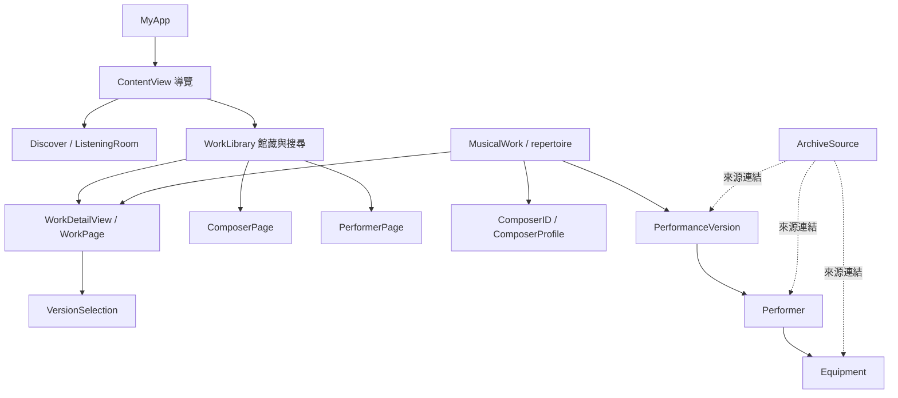
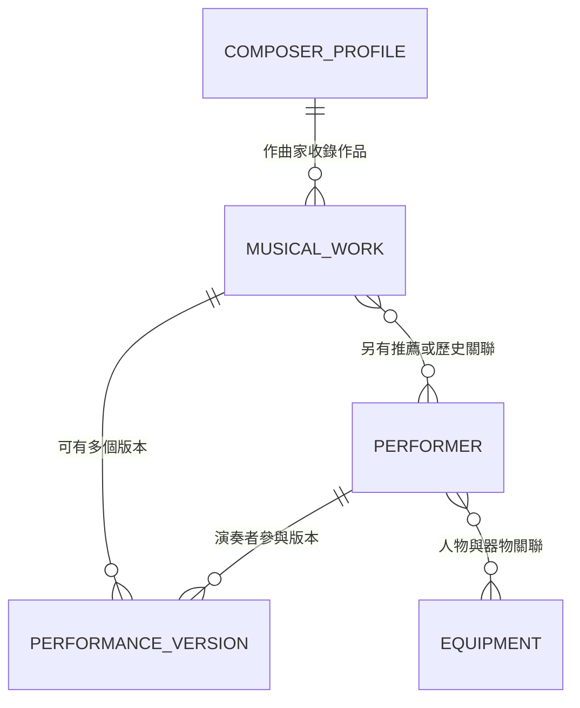

# Muselib｜App 介紹與架構摘要

## 一、App 介紹

Muselib 是一款以小提琴曲目為入口的古典音樂探索 App。它把作品介紹、作曲家背景、演奏者資料與可查證的演奏版本放在同一個閱讀與聆聽流程裡，讓使用者可以從「認識一首作品」開始，再往演奏、人物和音樂史的方向延伸。

這個 App 的策展重點是把**作品本身**和**某一份演出或錄音**分開記錄。作品介紹與聆聽線索不依附單一錄音；只有來源能確認的演出才會成為演奏版本。推薦人選、作品題獻或歷史關係都不會自動被當成錄音證據。

### 主要入口

| 區域 | 用途 |
| --- | --- |
| **Discover** | 隨機抽選一首作品，閱讀介紹並探索該作品已有的版本。 |
| **Repertoire** | 瀏覽及搜尋完整曲目，依作曲家、作品名稱或目錄編號查找。 |
| **Composers** | 閱讀作曲家介紹、生平節點與其在曲庫中的作品。 |
| **Violinists** | 瀏覽演奏者、作品演出版本與可查證的人物資料。 |
| **Saved** | 回看收藏的作品。 |

每首作品頁整合作品編制與編號、作品介紹、聆聽提示、作曲家入口、人物關聯及版本選擇。已收錄的比賽影片提供直接觀看入口；其他版本提供來源頁與 Apple Music 搜尋連結，搜尋結果仍需由使用者確認是不是對應的發行。

## 二、目前資料規模

- **60 首作品**，由核心曲目、擴充曲目和策展清單組成。
- **20 位作曲家**，每位皆有作曲家檔案。
- **12 位演奏者**的人物資料。
- **27 筆演奏版本**，目前涵蓋 12 首作品。
- 收藏資料儲存在裝置本機的 `UserDefaults`，不需要帳號或遠端服務。

其餘作品仍可瀏覽作品與作曲家內容，但目前沒有已收錄的演奏版本。未確認的錄音不會為了補滿曲目而建立。

## 三、架構一覽

Muselib 使用 SwiftUI 與以 Swift 檔案定義的型別化資料。資料由曲目、演奏版本、作曲家、演奏者和器物組成；畫面依照穩定 ID 把資料組合，不在各頁重複維護同一份關係。

### 核心資料關係

- **MusicalWork** 是作品層級資料：作品名稱、作曲家 ID、目錄編號、編制、介紹、聆聽提示與作品來源。
- **PerformanceVersion** 是單次演出或一份錄音的資料：連到一首作品和一位主演演奏者，並可記錄合作人員、版本類型、已確認年份、播放或轉播入口及來源。
- **ComposerID / ComposerProfile** 以穩定的作曲家 ID 連接作品與作曲家頁。作品列表由曲庫反向查詢產生。
- **Performer** 儲存演奏者人物介紹與來源；人物頁的作品由演奏版本、推薦配對和已標記的歷史關係彙整。
- **Equipment** 儲存小提琴或琴弓的描述與來源。人物使用過某件器物，不表示某份特定錄音使用了該器物。
- **ArchiveSource** 是可重用的來源連結，讓版本、人物和器物資料都能回到參考頁。
- **historicalConnections** 保留題獻或歷史關係；它不會被當成錄音，也不參與版本抽選。

## 四、主要使用流程

### 隨機探索

1. `ListeningRoom` 從 `repertoire` 中抽出一首作品。
2. `WorkPage` 顯示作品資料，並從該作品的 `versions` 中選出一筆初始版本（若有）。
3. 使用者可手動挑選版本，或在同一作品內切換到另一位演奏者。
4. 「探索另一首」排除目前作品，再從其他作品中抽選。

抽選先選作品、再選版本，避免版本數量多的作品提高抽中機率。沒有版本的作品仍能閱讀，不會以空白或猜測錄音取代作品內容。

### 搜尋與收藏

`WorkLibrary` 共用曲目列表和作品頁入口，依導覽區域顯示曲目、作曲家、演奏者或收藏。搜尋文字由頁面本地狀態管理。收藏只保存作品 ID，不複製作品資料；目前以 `@AppStorage("savedWorkIDs")` 寫入本機 `UserDefaults`。

### 多平台導覽

`ContentView` 在 iOS 使用 `NavigationStack` 與列表式入口；在其他支援平台使用 `NavigationSplitView`。館藏區域由 `LibrarySection` 定義，作品、作曲家與人物頁都沿用共用資料及導覽目的地。

## 五、資料與內容原則

1. **穩定 ID 優先**：作品、作曲家與演奏者之間用 ID 關聯，不以畫面顯示名稱做資料鍵。
2. **作品與版本分層**：導聆屬於作品；演出資訊屬於演奏版本。
3. **來源跟著資料走**：每筆已建立的版本記錄都要能指出所依據的來源。
4. **不補猜測資訊**：年份、合作人員、影片時間點及錄音用琴只在來源明確時填寫。
5. **推薦不是錄音證明**：`recommendedPerformers` 只標示推薦配對，不會生成 `PerformanceVersion`。
6. **歷史關聯不等於演奏**：題獻、師承或器物流傳等關係，不會被列為演奏版本。

## 六、程式碼地圖

| 檔案 | 責任 |
| --- | --- |
| `Muselib/MyApp.swift` | SwiftUI App 入口。 |
| `Muselib/ContentView.swift` | 建立平台導覽殼層與主要館藏入口。 |
| `Muselib/LibrarySection.swift` | 定義 Discover、Repertoire、Composers、Violinists、Saved。 |
| `Muselib/Repertoire.swift` | `MusicalWork` 模型、核心曲目、曲庫合併與推薦配對表。 |
| `Muselib/Repertoire+Expanded.swift` | 12 首擴充作品。 |
| `Muselib/Repertoire+Planned.swift` | 36 首其餘策展作品。 |
| `Muselib/PerformanceVersion.swift` | 演奏版本模型、版本集合與作品版本查詢。 |
| `Muselib/Composer.swift`、`Muselib/ComposerCatalog*.swift` | 作曲家 ID、作曲家頁資料與時間軸。 |
| `Muselib/Archive.swift` | 演奏者、器物、來源，以及歷史關聯。 |
| `Muselib/ListeningRoom.swift` | 隨機作品探索與收藏操作。 |
| `Muselib/WorkLibrary.swift` | 各館藏列表、搜尋與收藏篩選。 |
| `Muselib/WorkPage.swift`、`Muselib/WorkDetailView.swift` | 作品介紹、聆聽提示、人物關聯與頁面狀態。 |
| `Muselib/VersionSelection.swift` | 演奏版本資訊、版本切換、播放與來源入口。 |
| `Muselib/ArchiveViews.swift`、`Muselib/ComposerPage.swift` | 演奏者、器物及作曲家人物頁。 |
| `Muselib/PerformancePlayback.swift` | 官方影片 ID、來源 URL 與可選起播時間。 |
| `Muselib/LibraryComponents.swift`、`Muselib/WorkRow.swift`、`Muselib/WorkCover.swift` | 共用區塊、曲目列與作品識別封面。 |
| `REPERTOIRE_PLAN.md` | 策展曲目與編輯決策。 |

## 七、後續維護建議

### 加入一首作品

在核心、擴充或策展曲目檔新增 `MusicalWork`，指定全域唯一的 `id`、正確的 `ComposerID`、作品編號與來源。若新增獨立 Swift 檔，確認 Xcode 專案有納入該檔案。

### 加入一份錄音或演出

在 `performanceVersions` 加入 `PerformanceVersion`，使用既有的作品與演奏者 ID，並提供能識別該錄音或演出的來源。只有資料明確時才填年份、合作名單或播放時間。

### 新增人物

若演奏者 ID 尚不存在，先在 `artists` 建立對應的 `Performer`，提供名稱、簡介和來源，再建立引用該 ID 的版本資料。避免使用臨時或不相符的人物 ID。

### 更新作曲家頁

在相應的 `ComposerCatalog*.swift` 增修 `ComposerProfile`、章節、時間軸與引用來源。作品頁的作曲家入口會根據 `ComposerID.profile` 自動顯示；曲目列表由 `repertoire` 查詢產生。

## 八、平台與技術

- **UI**：SwiftUI
- **語言**：Swift
- **導覽**：iOS 使用 `NavigationStack`；其他平台使用 `NavigationSplitView`
- **本機狀態**：`@State` 管理頁面互動，`@AppStorage` 保存收藏 ID
- **資料來源**：隨 App 編譯的 Swift 型別化資料；來源連結開啟外部網站或音樂服務
- **平台目標**：Xcode 專案宣告支援 iOS、iPadOS 裝置家族、macOS 與 visionOS；目前最低 iOS Deployment Target 設為 27.0

這份文件描述目前程式碼中的架構與資料，不把規劃項目或尚未核實的錄音視為已完成功能。
