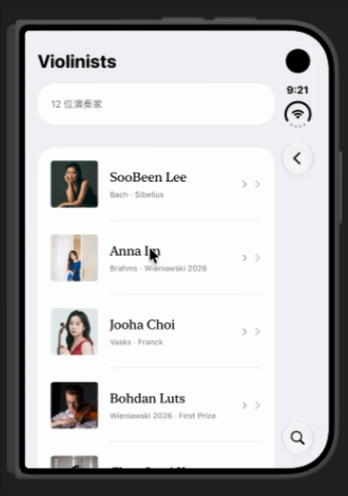

# Muselib

**Muselib** 是一座以小提琴曲目為起點的古典音樂聆聽圖書館。它把作品、作曲家、演奏者與已核對的演奏版本連在一起，讓人可以從一首作品出發，認識不同演奏，也能回到作曲家的創作脈絡。

> 先選一首作品，再挑一個版本聽。

## App 預覽

點選下方預覽圖，觀看 Muselib 演奏者列表的短片示範。

## 探索 Muselib

- **Discover**：隨機探索作品與其演奏版本。抽選先決定作品，再從該作品的版本中挑選，避免錄音較多的作品因此更常出現。
- **Repertoire**：瀏覽與搜尋 60 首曲目，依作品、編制與作曲家認識曲庫。
- **Composers**：閱讀作曲家介紹、重要生平節點與已收錄作品。
- **Violinists**：瀏覽演奏者資料、作品關聯與器物故事。
- **Saved**：集中查看收藏的作品。

作品頁提供作品背景、聆聽提示、相關人物與可用演奏版本。若版本有可播放的錄音或官方影片，頁面會提供相應入口；也可以查看來源，或用作品與演奏者資訊搜尋串流服務。

## 曲目與錄音資料

目前曲庫收錄 60 首作品：12 首核心曲目、12 首擴充曲目，以及 36 首策展清單曲目。演奏版本資料包含 27 筆，分布於 12 首已有版本的作品；其他曲目仍可先作為作品與作曲家探索入口。

版本紀錄只在有來源支持時建立。錄音年份與現場演出年份沒有確認便留空；唱片再版年份不會當作錄音年份。人物使用或持有的樂器，也不會被推定為某一份錄音的用琴。作品配對或推薦人選不等同於已確認錄音。

## 開始使用

1. 使用 macOS 上的 Xcode 開啟 `Muselib.xcodeproj`。
2. 選擇 `Muselib` scheme 與可用的 iOS、iPadOS 或 macOS 執行目標。
3. 執行專案，從側邊欄或行動裝置導覽列進入不同館藏。

專案以 SwiftUI 建置，支援 iPhone、iPad、Mac 與 visionOS 目標。建置設定中的最低 iOS 版本為 27.0；請使用支援該 SDK 的 Xcode 版本。

## 專案導覽

| 路徑 | 內容 |
| --- | --- |
| `Muselib/Repertoire.swift` | 核心曲目與作品資料模型 |
| `Muselib/Repertoire+Expanded.swift` | 12 首擴充曲目 |
| `Muselib/Repertoire+Planned.swift` | 36 首策展清單曲目 |
| `Muselib/PerformanceVersion.swift` | 演奏版本、作品與演奏者的關聯 |
| `Muselib/Archive.swift` | 演奏者、器物與來源資料 |
| `Muselib/Composer.swift`、`Muselib/ComposerCatalog*.swift` | 作曲家資料與生平內容 |
| `Muselib/ContentView.swift`、`Muselib/LibrarySection.swift` | 主導覽與館藏入口 |
| `Muselib/ListeningRoom.swift` | 隨機探索與版本抽選 |
| `Muselib/WorkLibrary.swift`、`Muselib/WorkPage.swift` | 曲庫瀏覽與作品頁 |
| `Muselib/ArchiveViews.swift`、`Muselib/ComposerPage.swift` | 演奏者與作曲家頁面 |
| `Muselib/VersionSelection.swift` | 手動挑選演奏版本 |
| `REPERTOIRE_PLAN.md` | 60 首曲目策展清單與選曲紀錄 |
| `LIBRARY_ARCHITECTURE.md` | 資料關係、抽選規則與內容架構說明 |

## 編輯資料

### 新增作品

在適合的 `Repertoire*.swift` 檔案新增 `MusicalWork`，指定唯一 `id`、作曲家、作品編號、編制、導聆內容與作品來源。完成後確認它已納入 `repertoire`，避免作品頁、搜尋與作曲家頁無法找到它。

### 新增演奏版本

在 `performanceVersions` 新增 `PerformanceVersion`，並引用既有的 `workID` 與 `performerID`。每筆版本應有能識別錄音或演出的來源；年份、合作人員及播放連結只在有資料支持時填入。官方影片可使用 `PerformancePlayback`，一般串流搜尋只作為搜尋入口，不代表特定錄音已被核實。

### 新增人物或器物

在 `Archive.swift` 新增 `Performer` 或 `Equipment`，使用唯一 ID，附上可支持人物介紹、器物故事與作品關聯的來源。作品的歷史關聯與實際演奏版本分開處理；題獻或歷史連結不應被寫成錄音。

## 相關文件

- [曲目策展清單](REPERTOIRE_PLAN.md)
- [App 介紹與架構摘要](APP_OVERVIEW.md)
- [資料與導覽架構](LIBRARY_ARCHITECTURE.md)
- [圖片資產整理](PHOTO_ASSETS.md)
